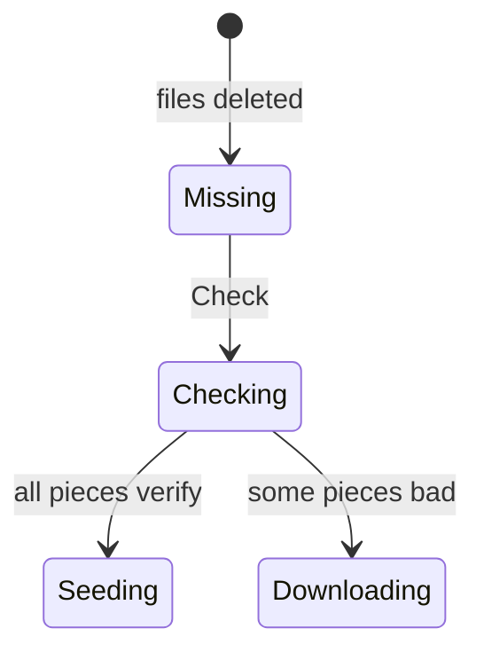

# Should Check also re-verify pieces that were complete?

Following up on your answer. The two options as a state machine:



Re-verifying everything costs a full read of the data:

```rust
fn check(torrent: &Torrent) -> Verdict {
    torrent.pieces().all(|piece| piece.verify())
}
```
