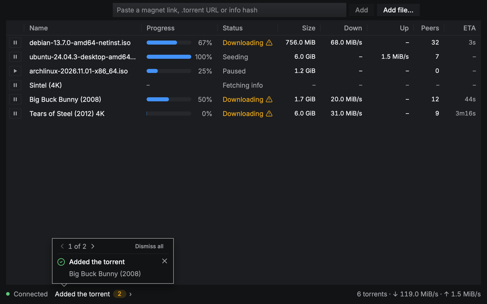
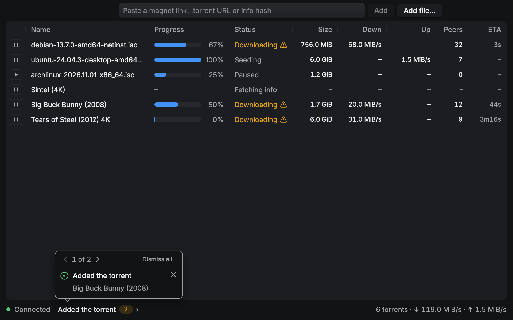
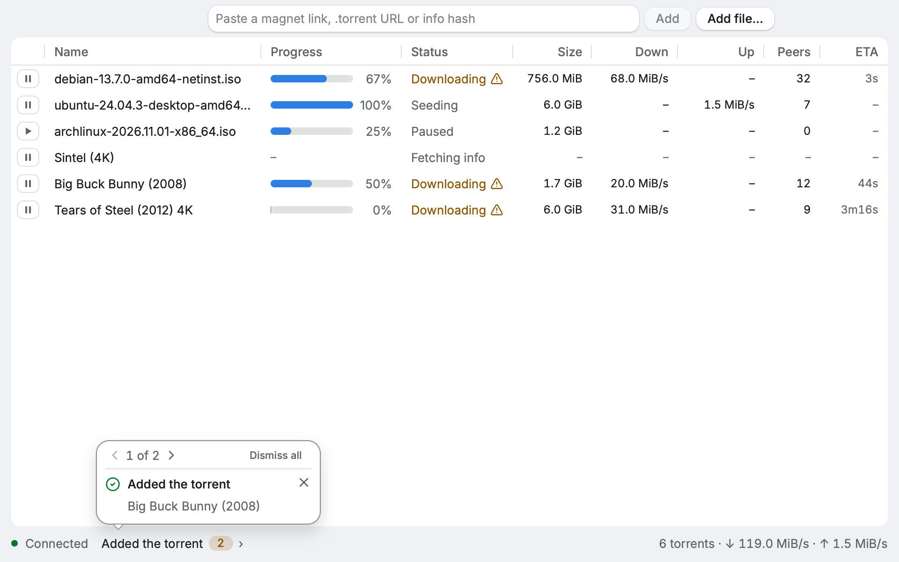
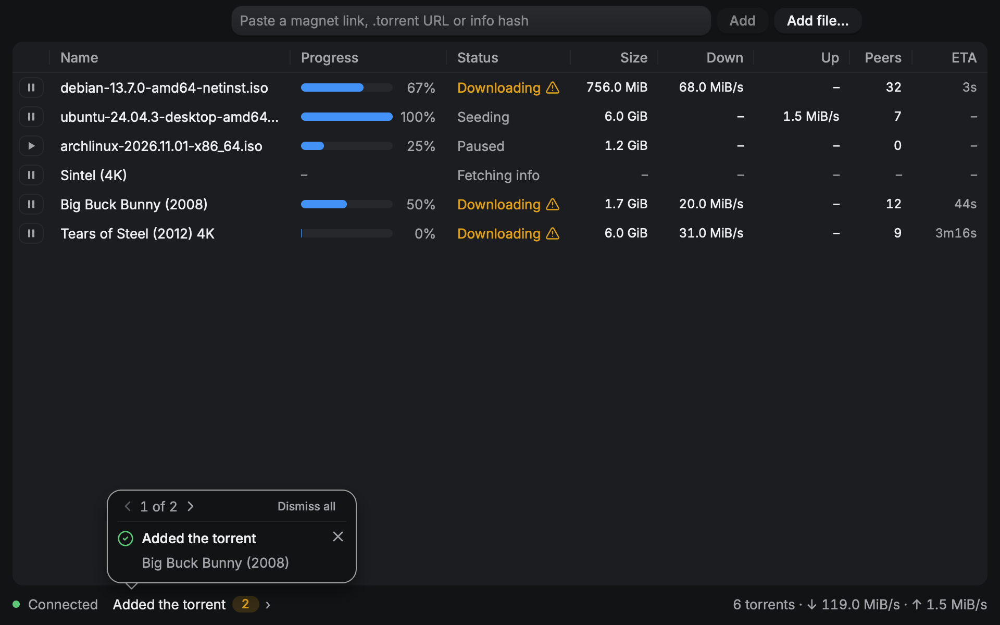
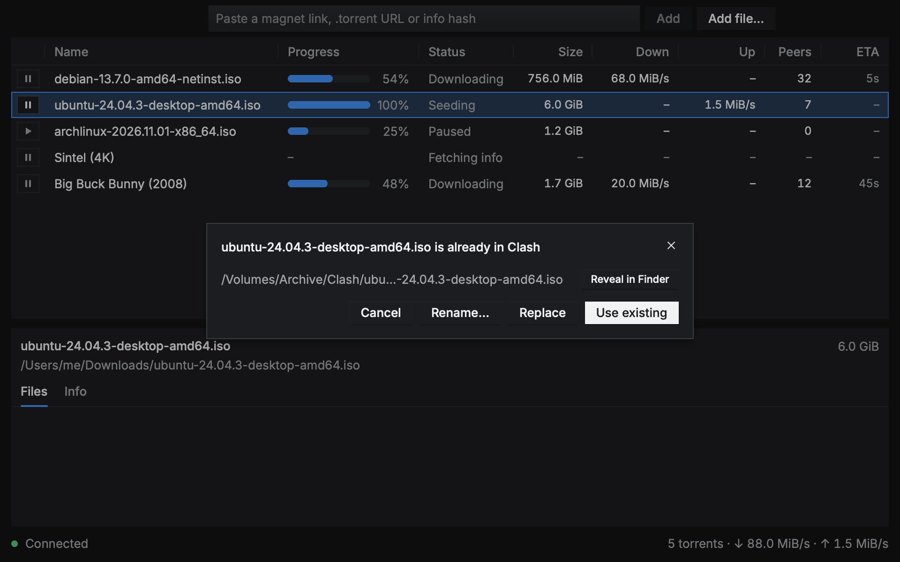
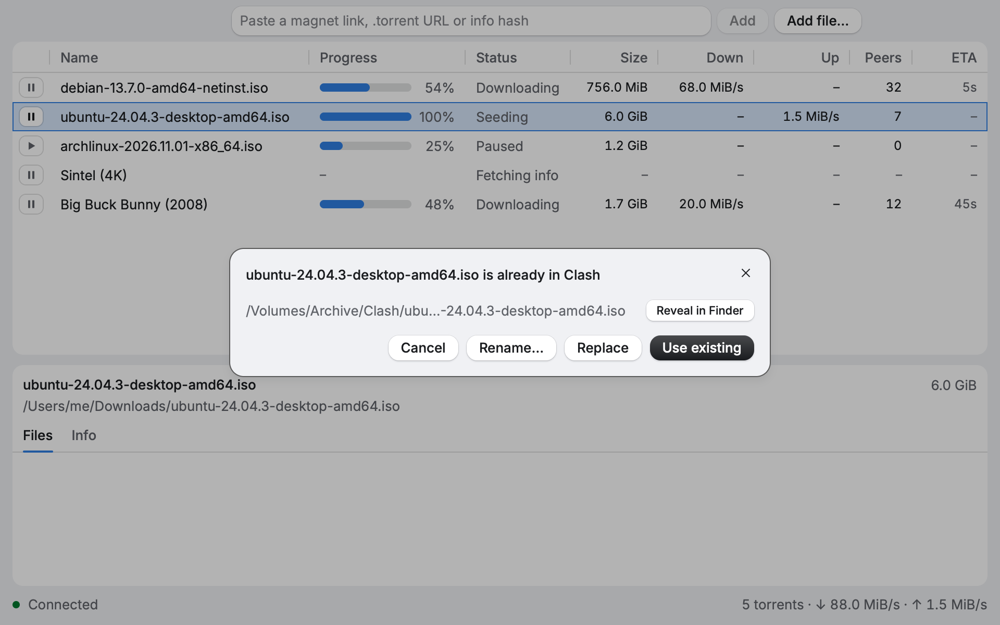
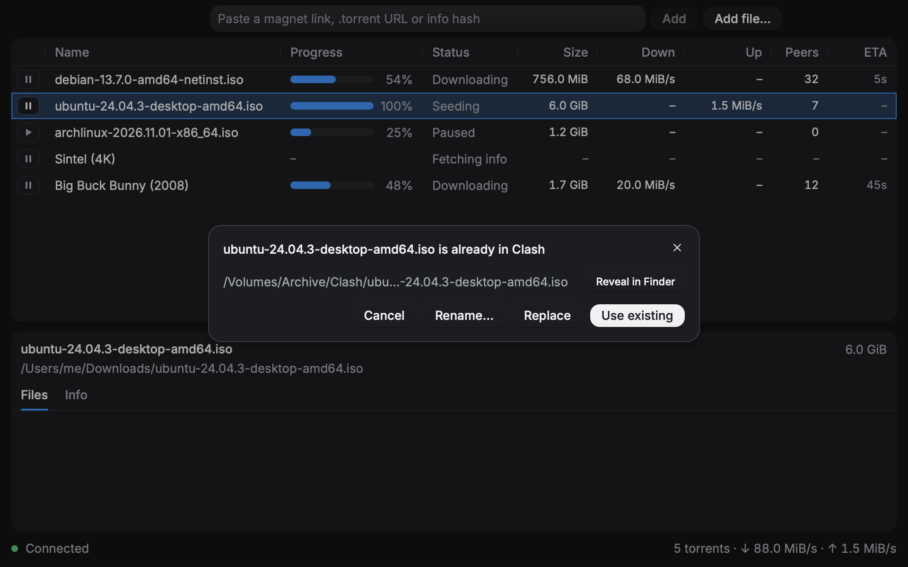

# Corners setting (#417), Square / Small / Round, Light and Dark

Small is today's look (the default).

| | Light | Dark |
|---|---|---|
| notices, square |  |  |
| notices, small |  |  |
| notices, round |  |  |
| dialog, square |  |  |
| dialog, small |  |  |
| dialog, round |  |  |
