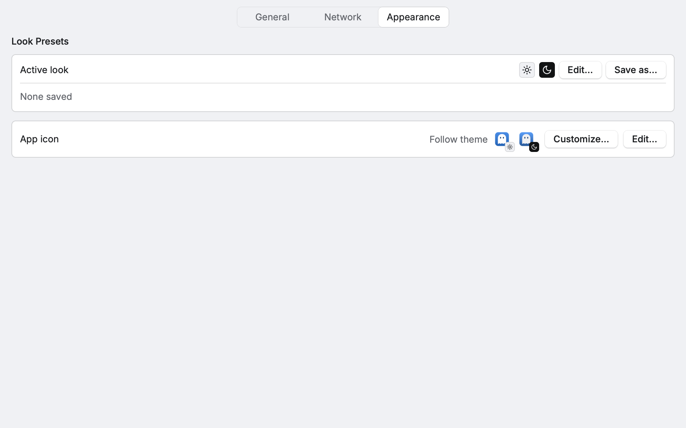
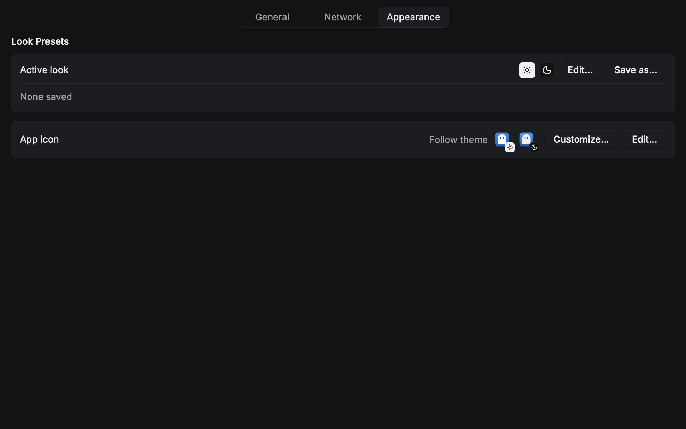
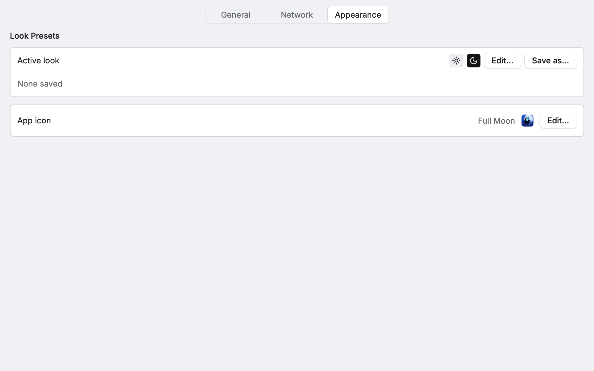
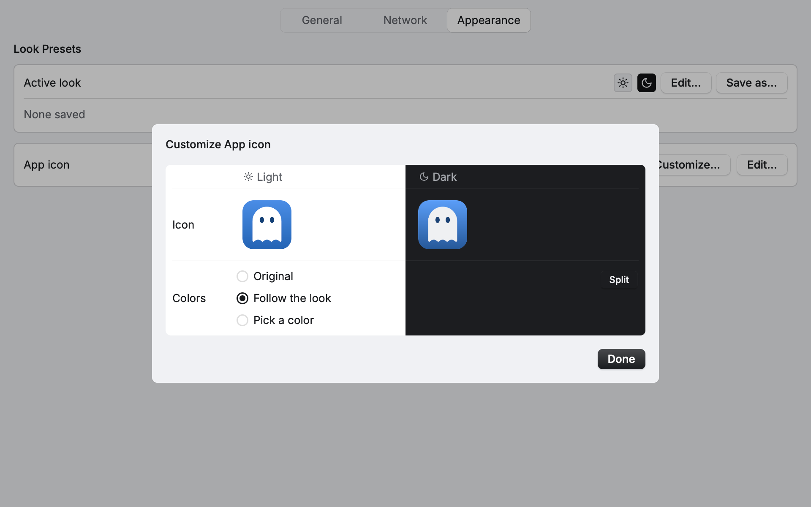
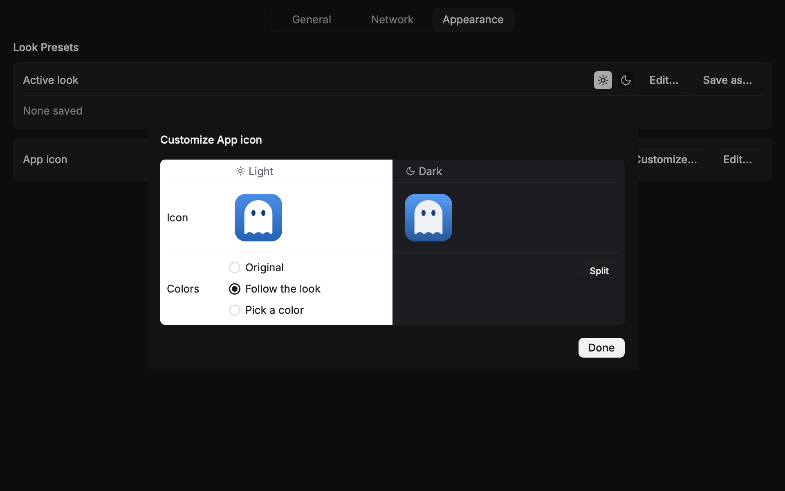
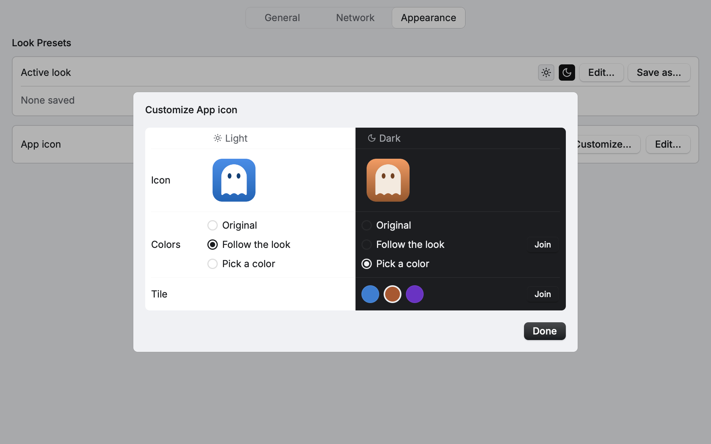
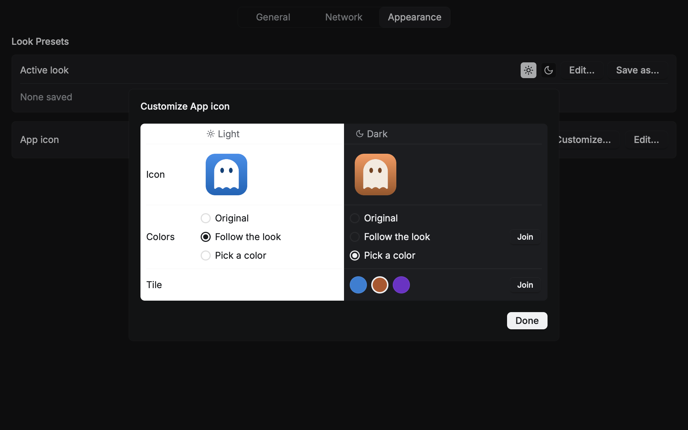
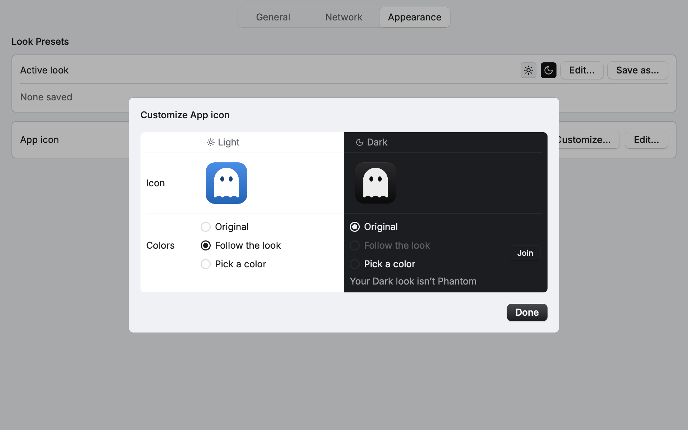
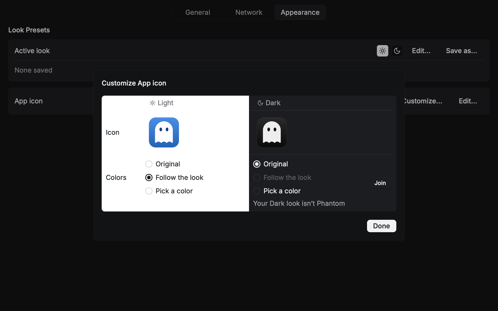

# #417 per-theme App icon settings: prototype stills

Throwaway prototype (branch `417-icon-settings`, no PR). Real headless Settings window, 960x600 @2x; each still in Light and Dark system appearance where it differs.

**Row.** `[preview] <name>  Customize…  Edit…`. Customize… shows only when the icon on screen has settings (Phantom's); not for a custom image or another designed icon.

- With Customize…:  
- Without (full-moon chosen): 

**Customize sheet** (Light and Dark columns, a preview of each half's icon on top, Split/Join per row).

- Follow the look in both halves:  
- Light follows the look, Dark Pick a color (Tile swatches):  
- Dark look isn't Phantom (stand-in theme): only Dark's "Follow the look" is greyed with "Your Dark look isn't Phantom", Original and Pick a color stay usable; Light is untouched:  

**Faked:** the pictures (the 1024px `icon-B-<set>-<tone>.png` and `icon-current.png` from `417-tinted-icon`, swapped by state; nothing is drawn from colors); the swatch colors (Blue/Orange/Purple, sampled from the today/warm/bold sets); all state (a thread-local set by the scenes; presses do nothing, Join/Split don't act); Customize… visibility (true when either half's icon is Phantom); the sheet's title and wording.
