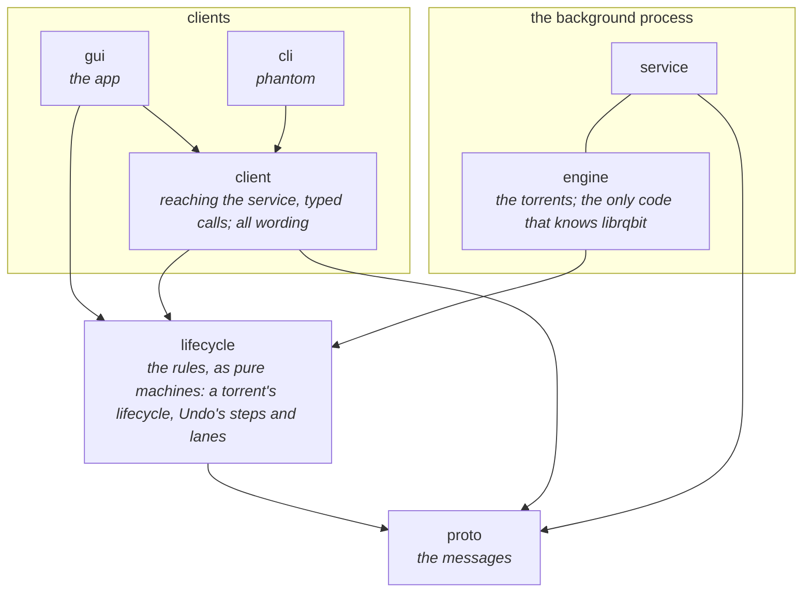

# Phantom architecture

A map of the code. Words follow [GLOSSARY.md](GLOSSARY.md); the reasons behind the big choices
are in [docs/adr/](docs/adr/). Each module's interface is documented at the top of its own
source file.

Arrows are compile-time dependencies (`engine` is a module of `service`). Every crate also sits on
`proto`; the arrows above show only the ones that explain the shape. `proto` and `lifecycle` are
the only crates both sides share; clients never depend on `service`, and nothing but `engine` uses
librqbit.

At runtime, requests flow from a client through `client` and the socket to `service` and its
`engine`, and answers flow back. `lifecycle` is never on that path: it's a library each side runs.

`lifecycle` is the functional core: pure `decide(state, event)` and `next(state)`, no I/O. Two
shells run it, each carrying out what it says and reporting back what happened:

- **the engine**, with real librqbit and real files;
- **the GUI's fake service** (`gui/src/service/memory.rs`), an in-memory stand-in for the whole
  service with a pretend librqbit and disk, used by the GUI's tests and headless renders (GIFs,
  stills).

Both run the same machines, so the GUI can't drift from the engine's rules.

## Crates and modules

| Where | Job |
|---|---|
| `proto/` | The messages and the data they carry, and where the service's socket is (the data dir); `tolerant`, the one decoder of a settings file that resets what's invalid. No I/O but the files named: the full list of what a client can ask. |
| `lifecycle/` | A torrent's lifecycle, the engine's and the GUI's fake's: what's wanted, its phase, `decide`, `next` and `answer` (what each action would do now, #89) ([ADR 0006](docs/adr/0006-torrent-lifecycle-as-an-actor.md)); `undo`: Undo's machine (#150, #190, [ADR 0008](docs/adr/0008-undo-is-inverse-commands-in-the-service.md)), the engine's and the fake's: the undo stack, in the order commands came, and a lane per torrent, in which every command for it is a step (a Remove, a Delete, a Move to Trash, an undo of one, any other command), run one at a time per torrent, side by side across torrents; one press is one step (#235): a Remove or Delete of a selection is one, with a part per torrent that reports on its own, one entry on the stack; it says which parts to start; `undo::view`: what clients see of the torrents as their steps make them, one fold for the engine's rows and the fake's; `seeding`: seeding limits, a round's count of what it uploaded and how long it seeded, and when it reached a limit; what a size check finds as plain data (`disk`). `machine`: the `Machine` trait every machine implements, `Every` and `every!` (samples of every variant, which a new one can't skip), and, for tests (feature `harness`), the table and sequence harness. |
| `client/` | Reaching the service: the connection machine (`client::machine`: connect, replace a service from another build or one that's stopping, start one, lose it; `route` says whether a request is held, run or refused, and `Requests` holds them in order), which the CLI and the app's link thread share; one method per request; `display`, the one module for text people see (sizes, durations, the words for the service's typed reasons), shared by clients. |
| `service/` | The background process: one per data dir, the socket, its lifetime as a machine (`service::machine`: idle shutdown, restarting the engine when the listening port or UPnP changes, during which requests that need the engine wait and the rest are answered, refusing every request while it stops; a Shutdown's connection closes only once it refuses, so a client that reconnects never reaches it), settings (`settings.json`: the default destination, the listening port as its own machine, `settings::machine`, UPnP, keeping the Mac awake, the speed limits, which the engine sets on the running session: nothing restarts); a .torrent URL is fetched before its add reaches the engine. `awake`: an actor that holds macOS's power assertion exactly while the setting is on and the engine's latest snapshot has a torrent Downloading, Fetching info or Checking, released when the service stops (`awake::machine`). |
| `service/src/engine/` | Torrents: add (each into its destination), list, details, priorities, pause, check, cancel a check, remove. One actor task owns every torrent's lifecycle, what's wanted plus a phase, decided by `machine/` from the facts the actor reports, and its librqbit side (adding, never added, in librqbit, resuming from the pieces it had, or taken out: `machine/inlib.rs`), and lists what can be done to each ([ADR 0006](docs/adr/0006-torrent-lifecycle-as-an-actor.md)); after every event it publishes a snapshot (the list and the torrents' details) when it changed, numbered within an epoch (each start of the engine is a later one), which the service pushes to each subscribed connection (`Subscribe { watching }`, at most every 100 ms, the latest only, on across an engine restart) with the details it watches, the list it was built for and the settings reset at start; clients keep the latest by `(epoch, version)`; owns torrent ids and de-duplication; watches destinations for files deleted outside Phantom and for destinations that can't be reached (never creating a missing one); neither a check, a restart nor an undo makes a file set Off that isn't there, its priority held or applied (only a piece it shares with a file the torrent gets is written into it; a restart reads each torrent's folder and priorities from librqbit's `session.json` first, `session_db.rs`); has each destination's disk looked at off the actor (`statfs`, and what's allocated to each file, in a thread per look with a timeout, readings back as messages; a stalled disk's free space is unknown) and puts in each snapshot the disks torrents still need space on, with what each needs and what's free (`space.rs`: a warning, never a block; clients show it on every torrent that needs space there, a ⚠ with the disk's picture on hover), and watches the default destination as it does a torrent's, off the actor with the same timeout, so each snapshot says why it can't be reached, if it can't (`default_folder.rs`; the service tells it which folder it is); keeps `engine.json` in the data dir. `actor/steps.rs`: every command is a step of Undo's machine from the moment it comes (#190), through `Steps`: a step arrives (a Remove or Delete of several torrents one step, a part each: #235), the actor carries out what the machine says next, part by part, reports what each did, and its client hears how it went once every part did (and ⌘Z); the torrents are listed as their steps make them (`lifecycle::undo::view`) (a Remove's or Delete's gone at once, one an Undo takes back listed again as it was, a Move to Trash's files Off at once). `undo.rs` and `actor/undoing.rs`: Undo ([ADR 0008](docs/adr/0008-undo-is-inverse-commands-in-the-service.md)): a Remove, or a Delete that moved something or took its torrent off the list, puts what reverses it on a stack of 20, kept in `undo.json` (with why the entries that left it did, the last 64, which every snapshot carries: #200) with a folder per torrent kept aside (its .torrent and librqbit's `.bitv`, hard-linked from the session folder before librqbit deletes them); an undo is checked on the disk as it is (each item in the Trash as it went, its path free, no link on the way), puts back what Delete moved on a blocking task (`trash.rs`, held at the trash's gate in tests), then adds the torrent again under its id, without a full check while its files are as they were kept; every step is written ahead, and `undo.json` loads whatever it holds. `actor/filetrash.rs`: Move to Trash for files (#151): the files set Off first, then moved on the same blocking trashing (`trash::plan_files`, never through a link, off the actor), each move written ahead into its step, the torrent's other commands waiting on its lane; what moved is one undo entry that puts back what's still in the Trash and each file's priority. A trashing an Undo aborts stops after the item in flight (`trash::carry_out_until`). `trashed.rs`: a file in the Trash for an undo (#218): a Move to Trash takes it, librqbit's storage (Phantom's own, `Files`) reads it where it went and never changes it there nor makes it again at its path, what librqbit writes into it is kept aside in `undo-parts/` until its undo puts it back, which files those are follows the undo stack, and whether the undo checks the torrent; one gone from the Trash while librqbit has it open is found and closed. `actor/letgo.rs` and `machine/letgo.rs`: letting go of it (#234): its torrent is taken out of librqbit and added back without its pieces (librqbit can't withdraw a piece it has), its row as it was, each step written ahead in its record, so a start finishes one a crash cut short. |
| `cli/` | Parses arguments and prints. |
| `gui/src/service/` | The GUI's seam to the service: a trait with a socket implementation (one link thread owns the connection and subscribes on it, nothing polls; commands are messages to it) and an in-memory fake for tests and headless runs: an actor without a thread, whose mailbox the app clock drains, running each torrent's shared lifecycle against a pretend librqbit and disk. |
| `gui/src/pane/` | The details pane as a machine (Empty, Waiting, Showing, Switching): it draws only from one snapshot, and keeps the shown torrent, live, until the selected one's details come. |
| `gui/src/model.rs` | App state and what actions do to it. No drawing. A disk short of space has no notice: its place is the rows it affects (`views/space.rs`, #209). |
| `gui/src/notice.rs` | `Notice`, a short line, a severity (a failure is an Error) and optionally a view, with the `explained` preset, whose actions show their shortcut and, while off, say why when pressed (a Remove or Delete's Undo). |
| `gui/src/bar/` | The status bar's notices: told once (an add, the settings reset, every failure: a batch is one error notice, its list as the view), each with a ×; conditions have no notice, they're shown where they belong while they hold (the machine's doc says how one with no such place would be kept); its `machine` decides them, what a click on the bar does, and whether their popover is open (Escape goes to it first). The bar shows the newest with which of how many it is (1/3); a click opens a popover above it showing one at a time with its view, and ‹ › or ← → step through them, newest first, stopping at the ends; what's shown follows the notice, so one told elsewhere never moves it, and when it goes the next older one is shown. The popover is modal (focus in it while open, back after); it scrolls when the window is short. An Error is told like any notice and never opens the popover: it shows in the bar in the error colour with the count, and a click opens it. Told notices, errors included, are kept up to `MAX_TOLD` (50), the oldest dropped; a notice told while the popover is open leaves it on the one you're reading, and only the count grows; Dismiss all ("Dismiss n messages") clears every one and closes it; ← → step with the focus inside, and × leaves the focus on ×. |
| `gui/src/overlay.rs` | One overlay at a time: the notices popover and the menus. Opening one closes the other. |
| `gui/src/views/` | Screens: what's shown and which actions exist, drawn through `ui`. `file_menu`: the context menu of the selected files and, with the file list focused, what ⌘O, ⇧⌘O and ⌘⌫ do (the same table as for torrents, `shortcuts::file_item`). |
| `gui/src/ui/` | Building blocks every screen draws with, from a look's tokens (a rune-kit `Kit`); `blocks`: those a theme can draw itself (icons, the progress bar, the status dot), closures it builds from its Theme Look's settings, each resolved whole ([ADR 0004](docs/adr/0004-themes-override-building-blocks.md)). |
| `gui/src/theme/` | Themes ([ADR 0011](docs/adr/0011-look-presets.md)): the `Theme` trait (given its settings, a theme builds tokens, block and screen overrides and its App icon), `Look::build` (blocks and screens through theme → parent → Phantom), `setting` (typed descriptors: toggle, choice, colour; values by key, a bad one reset and named), `preset` (the Active Look Preset in `gui.json`, and `Looks`: the two resolved looks, a change rebuilding only its half), `phantom/` (the default theme: Tone, its icons). `gui/src/settings.rs`: `gui.json`, repaired at startup; `settings/file.rs`, the one place that reads a key of it and changes one afterwards (the App icon, the icon written, the Look Preset), re-reading and writing it whole each time. |
| `gui/src/platform/` | macOS integration: magnet links, files opened from Finder, Reveal in Finder, the App icon (choice and manifest resolved purely; AppKit sets the Dock and bundle icons), the menu bar's own item (Settings…; Edit is Rune's standard menu, whose Undo hands ⌘Z to the window). |
| `design/` | Icons and theme references. |

## Principles

- **A right model makes edge cases disappear.** Many special cases mean the model is wrong or too
  loose. Fix the model (its states, who owns what, the types) so the case can't happen or follows
  from the general rule; don't add another branch.
- **Odd scenarios test the model; they aren't features.** "Delete while moving" or "the drive
  vanishes mid-check" ask whether the model already covers them. The answer should be "yes, by
  the general rule", not new code.
- **Less logic, not fewer lines.** A better model often adds lines (a struct, a service, an
  interface) and removes branches; that's the trade we want. Dense one-liners aren't simpler.
  Leave out what nothing needs yet.
- **One thought-out shape over many cases.** Code that keeps asking what kind of thing it holds
  (`if list.is_empty()`, `if first.kind == A`, `if any(kind in [A, B])`) usually means the model
  is missing a concept. Prefer one shape whose behaviour follows from it, but not a struct full of
  optional fields, which is the same `A | B | C` hidden. A real sum type (a `Result`, a phase) is
  fine when the cases genuinely differ.
- **Parse, don't validate** ([lexi-lambda](https://lexi-lambda.github.io/blog/2019/11/05/parse-don-t-validate/)):
  check input once at the edge and turn it into a type that can only hold valid values (a
  `Destination`, not a path checked in three places); code past the edge takes that type.
- **The service states typed reasons; clients word them.** Refusals and errors cross the protocol
  as data (an enum with its facts), never as sentences. Wording lives in `client`, shared by the
  CLI and the GUI, like an HTTP status the server sends without writing the page.
- **State with rules is a state machine; long-lived concurrent state is an actor.** A flag or an
  `Option` that decides what may happen next is a machine's state in hiding: write the state ×
  event table out, every pair decided (#110). An actor owns the state no one else touches.
  Reach for this pair first, in the GUI too: the status bar's notices and the details pane are
  machines that `decide` each event sent them, so how they're shown can change while delivery stays the same.
  Every machine uses the same names, in a `machine` module: `State`, `Event` (`Command(..)` or
  `Observed(..)`, raw facts), `Do` (what the actor carries out), `decide(&State, &Event) ->
  Result<State, Refusal>` (one match, no `_` arm) and `next(&State, ..) -> Option<Do>`, and
  implements `lifecycle::machine::Machine`; the torrent's lifecycle (`lifecycle/`) is the
  reference.
- **Everything on screen is ours to theme.** No native-looking controls (menus, popups, alerts):
  a theme restyles all of it ([ADR 0004](docs/adr/0004-themes-override-building-blocks.md)).
  Native stays only where macOS draws it outside the window: the menu bar, the Dock, file pickers.
- These are heuristics and taste, not rules.

## Rules

- Each module gets the narrowest input it needs: a helper takes the table state, not the app.
- Tests go through interfaces: GUI behaviour through `model` and the views against the fake
  service, the engine against a real session in a temp dir, the protocol end to end through
  `client`.
- Tests assert properties rather than hand-written outcomes: a machine's table over every
  state × event pair, each in exactly one row with its property, and generated event sequences
  checked against the same rows (`lifecycle::machine`'s harness, from `every!` samples), the engine and the GUI over generated sequences against a reference model
  (`engine/model_tests.rs`, `gui/src/tests/generated.rs`; `PROPTEST_CASES` runs more), and the
  engine's add tasks, held at gates, against generated commands and restarts, downloading from a
  local seeder that has half of each torrent, so progress never goes down across a restart
  (`engine/race_tests.rs`). A new behaviour or a bug starts there, as a property or a step of the
  generated sequences; an example test is the exception, for what truly can't be generated, and
  the PR says why. A behaviour that's hard to state as an always-true property, or a bug the
  generated tests can't reach, usually means the model, or the fake, is wrong or missing something
  (e.g. answers that are never late).
- The service reports its build id (`proto::exe_id`: a hash of its own executable); a client replaces a service whose id isn't that of the `phantom-service` it would start. Nothing is bumped by hand.
- Hard parts go to dedicated, well-maintained crates rather than our own code; agree on each new
  dependency with the user before adding it.
