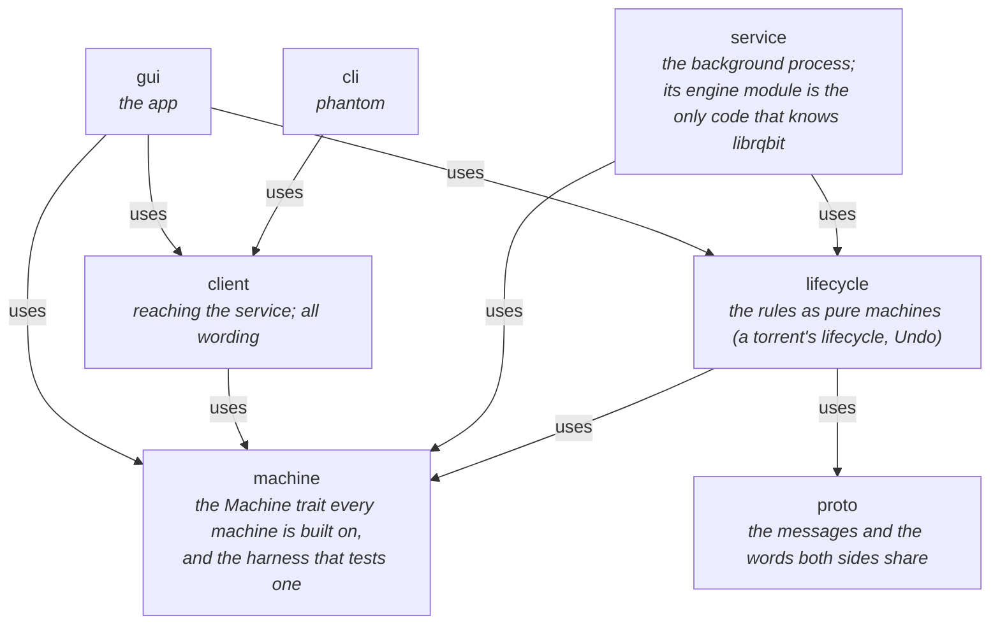
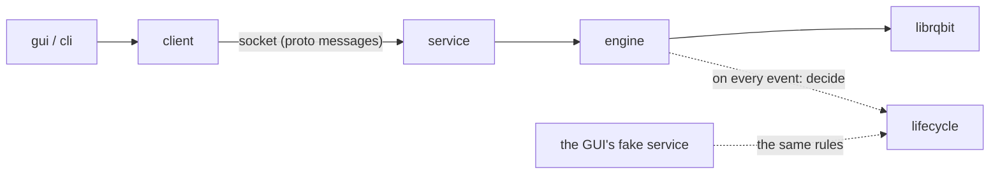

# Phantom architecture

A map of the code. Words follow [GLOSSARY.md](GLOSSARY.md) and, per domain, [gui](gui/GLOSSARY.md) and [service](service/GLOSSARY.md); the reasons behind the big choices
are in [docs/adr/](docs/adr/). Each module's interface is documented at the top of its own
source file.

An arrow means "uses" (imports, at compile time), not "talks to" at runtime. Every crate also uses
`proto`; only `lifecycle`'s arrow to it is drawn. `proto`, `machine` and `lifecycle` are the only
crates both sides share, and `client` uses no `lifecycle`; clients never depend on `service`, and nothing but the engine, a module of `service`,
uses librqbit.

Why each one:

- **`gui` uses `machine`** for the `Machine` trait its own machines are built on (the notices
  bar, the pane, the menu), and **`lifecycle`** for its fake service, which runs the torrent and
  Undo machines.
- **`client` uses `machine`** for the trait its connection machine is built on. Undo's depth, which
  its wording names ("Only the last 20…"), is in `proto`.
- **`service` uses `lifecycle`**: the engine runs the torrent and Undo machines; and **`machine`**,
  for the trait the service's own machines (settings, the process) are built on.
- **`lifecycle` uses `machine`**: the torrent and Undo machines are built on the trait.
- **`lifecycle` uses `proto`**: the machines decide in the same types that go over the wire
  (`Status`, `Action`, `Refusal`), so nothing is translated between them.

At runtime it looks different: `proto` and `lifecycle` aren't stops on the way (`machine` is only the shape of a machine). `proto` is the
format of the messages on the socket, and `lifecycle` is what the engine consults on every event
(a command, a report from librqbit, a file move ending): `decide(state, event)` gives the new state
and what to do, and the engine does it.

Answers and snapshots come back the same way, from the engine through `service` and the socket to
`client`.

`lifecycle` is the functional core: pure `decide(state, event)` and `next(state)`, no I/O. Two
shells run it, each carrying out what it says and reporting back what happened:

- **the engine**, with real librqbit and real files;
- **the GUI's fake service** (`gui/src/service/memory.rs`), an in-memory stand-in for the whole
  service with a pretend librqbit and disk, used by the GUI's tests and headless renders (GIFs,
  stills).

Both run the same machines, so the GUI can't drift from the engine's rules.

## Crates and modules

| Where | Job |
|---|---|
| `proto/` | The messages and the data they carry, and where the service's socket is (the data dir); `tolerant`, the one decoder of a settings file that resets what's invalid. No I/O but the files named: the full list of what a client can ask. |
| `machine/` | What every machine is: the `Machine` trait, `Every` and `every!` (samples of every variant, which a new one can't skip), and, for tests (feature `harness`), the table and sequence harness. No dependencies but `proptest`, for the harness. |
| `lifecycle/` | A torrent's lifecycle, the engine's and the GUI's fake's: what's wanted, its phase, `decide`, `next` and `answer` (what each action would do now, #89) ([ADR 0006](docs/adr/0006-torrent-lifecycle-as-an-actor.md)); `undo`: Undo's machine (#150, #190, [ADR 0008](docs/adr/0008-undo-is-inverse-commands-in-the-service.md)), the engine's and the fake's: the undo stack (its depth, `proto::UNDO_DEPTH`, is in `proto`, the contract with clients); `moving`: a Move's stages (#24: taken out of librqbit, copying, removing the old, or restoring; a Rename, #331, is a Move within its destination under a new name), the engine's and the fake's, in the order commands came, and a lane per torrent, in which every command for it is a step (a Remove, a Delete, a Move to Trash, an undo of one, any other command), run one at a time per torrent, side by side across torrents; one press is one step (#235): a Remove or Delete of a selection is one, with a part per torrent that reports on its own, one entry on the stack; it says which parts to start; `undo::view`: what clients see of the torrents as their steps make them, one fold for the engine's rows and the fake's; `seeding`: seeding limits, a round's count of what it uploaded and how long it seeded, and when it reached a limit; what a size check finds as plain data (`disk`). `settings`: the service's settings changes (#221), the service's and the fake's: each with what its setting was, newest last, the last 20. |
| `client/` | Reaching the service: the connection machine (`client::machine`: connect, replace a service from another build or one that's stopping, start one, lose it; `route` says whether a request is held, run or refused, and `Requests` holds them in order), which the CLI and the app's link thread share; one method per request; `display`, the one module for text people see (sizes, durations, the words for the service's typed reasons), shared by clients. |
| `service/` | The background process: one per data dir, the socket, its lifetime as a machine (`service::machine`: idle shutdown, restarting the engine when the listening port or UPnP changes, during which requests that need the engine wait and the rest are answered, refusing every request while it stops; a Shutdown's connection closes only once it refuses, so a client that reconnects never reaches it), settings (`settings.json`: the default destination, the listening port as its own machine, `settings::machine`, UPnP, keeping the Mac awake, the speed limits, which the engine sets on the running session: nothing restarts), each change that takes effect kept, in memory, for `UndoSetting`, which takes the newest back whoever made it (#221), and the settings with those changes in every snapshot, sent again at once when they change; a .torrent URL is fetched before its add reaches the engine. `awake`: an actor that holds macOS's power assertion exactly while the setting is on and the engine's latest snapshot has a torrent Downloading, Fetching info or Checking, released when the service stops (`awake::machine`). |
| `service/src/engine/` | Torrents: add (each into its destination), list, details, priorities, pause, check, cancel a check, remove. Phantom's record of each torrent is the torrent (#45, `store.rs`): its .torrent, destination, priorities and what's wanted; the engine adds every torrent to librqbit itself, at a start too, and librqbit's session only keeps the pieces each has (`.bitv`). One actor task owns every torrent: its record, its lifecycle, what's wanted plus a phase, decided by `machine/` from the facts the actor reports, and its librqbit side (being added, in librqbit, resuming from the pieces it had, or out of it: `machine/lib.rs`, whose `reconcile` says what makes librqbit match the lifecycle and the record: resume, check, start, stop, take out, push the priorities; one away or not checked is out of librqbit, and checked in full once it's back; one missing files stays stopped in librqbit, the handle of a file deleted by hand closed by the size checks' look, off the actor, so its space is freed, and at a start isn't added until it's checked or Ready again; one resuming, at every start too, is listed as its record says while librqbit samples its pieces, which counts as running on its lane: what's asked meanwhile is held there, shown done, and runs right after), and lists what can be done to each ([ADR 0006](docs/adr/0006-torrent-lifecycle-as-an-actor.md)); after every event it publishes a snapshot (the list and the torrents' details) when it changed, numbered within an epoch (each start of the engine is a later one), which the service pushes to each subscribed connection (`Subscribe { watching }`, at most every 100 ms, the latest only, on across an engine restart) with the details it watches, the list it was built for and the settings reset at start; clients keep the latest by `(epoch, version)`; owns torrent ids (above every id `undo.json` names, at a start) and de-duplication; watches destinations for files deleted outside Phantom and for destinations that can't be reached (never creating a missing one); neither a check, a restart nor an undo makes a file set Off that isn't there (only a piece it shares with a file the torrent gets is written into it): every add takes its folder and priorities from the record; has each destination's disk looked at off the actor (`statfs`, and what's allocated to each file, in a thread per look with a timeout, readings back as messages; a stalled disk's free space is unknown) and puts in each snapshot the disks torrents still need space on, with what each needs and what's free (`space.rs`: a warning, never a block; clients show it on every torrent that needs space there, a ⚠ with the disk's picture on hover), and watches the default destination as it does a torrent's, off the actor with the same timeout, so each snapshot says why it can't be reached, if it can't (`default_folder.rs`; the service tells it which folder it is); keeps the records in a libsql database in the data dir (`records.db`, #243, [ADR 0012](docs/adr/0012-the-record-in-a-database.md)): a row per torrent by info hash, its record as JSON and its .torrent as a blob, and the next id; every save writes, as one transaction, the rows that changed since the last one, so a write-ahead step rewrites only its torrent's row and a crash leaves one save or the one before; librqbit's own list (`session.json`) is deleted at every start, so librqbit restores nothing; a record without its .torrent takes librqbit's copy (it had the torrent, and the engine hadn't heard as it stopped); a record whose .torrent can't be read is kept, an error until a Check reads it; a row whose record can't be read stays in the database, out of the list; a database that can't be read is kept aside as it was (`records.invalid.db`) and the service starts with none, saying where in every snapshot and in the settings for as long as that run lasts (`records_set_aside`, #308; the app warns once, the CLI's `settings` prints a line); nothing that can't be read is deleted. `machine/add.rs`: an add's stages (#322: asked, held while its hash is busy, fetching, done, failed, existing, removed, or an orphan librqbit has that nobody listed), decided for the duplicate check, the add task's end and a Remove during it. `actor/steps.rs`: every command is a step of Undo's machine from the moment it comes (#190), through `Steps`: a step arrives (a Remove or Delete of several torrents one step, a part each: #235), the actor carries out what the machine says next, part by part, reports what each did, and its client hears how it went once every part did (and ⌘Z); the torrents are listed as their steps make them (`lifecycle::undo::view`) (a Remove's or Delete's gone at once, one an Undo takes back listed again as it was, a Move to Trash's files Off at once). `undo.rs` and `actor/undoing.rs`: Undo ([ADR 0008](docs/adr/0008-undo-is-inverse-commands-in-the-service.md)): a Remove, or a Delete that moved something or took its torrent off the list, puts what reverses it on a stack of 20, kept in `undo.json` (with why the entries that left it did, the last 64, which every snapshot carries: #200) with a folder per torrent kept aside (its .torrent, from its record, and librqbit's `.bitv`, hard-linked from the session folder before librqbit deletes it); an undo is checked on the disk as it is (each item in the Trash as it went, its path free, no link on the way), puts back what Delete moved on a blocking task (`trash.rs`, held at the trash's gate in tests), then adds the torrent again under its id, without a full check while its files are as they were kept; every step is written ahead, and `undo.json` loads whatever it holds. `actor/filetrash.rs`: Move to Trash for files (#151): those on disk only (#276), set Off first, then moved on the same blocking trashing (`trash::plan_files`, never through a link, off the actor), each move written ahead into its step, the torrent's other commands waiting on its lane; what moved is one undo entry that puts back what's still in the Trash and each file's priority. A trashing an Undo aborts stops after the item in flight (`trash::carry_out_until`). `trashed.rs`: a file in the Trash for an undo (#218): a Move to Trash takes it, librqbit's storage (Phantom's own, `Files`) reads it where it went and never changes it there nor makes it again at its path, what librqbit writes into it is kept aside in `undo-parts/` until its undo puts it back, which files those are follows the undo stack, and whether the undo checks the torrent; a part that fails to reach the disk stays in memory and is tried again at each `follow` (every change to the undo stack, and the size check), and one that fails again is in every snapshot (`parts_not_saved`, #304: a list, as it can start and end in a run; the app warns once per file while it's listed); one gone from the Trash while librqbit has it open is found (off the actor, through `looks.rs`) and closed, never waiting on librqbit. `moving.rs` and `actor/moving.rs`: a Move (#24, `lifecycle::moving`): a step on its torrent's lane until it's over; folders told by volume and inode, not spelling (into its own folder: refused as there already; into one inside it: refused); its plan refused on a clash (or a link on the way) unless the client chose, the torrent kept aside with its `.bitv` and taken out of librqbit, its files staged in the new destination (each renamed, or copied in chunks on a blocking task that reports progress and stops between chunks, and its folders flushed), the new destination and what's staged of each file written ahead in the record (a save that fails stops the move), then each placed, checked again just before (`RENAME_EXCL`, no link on the way, nothing new at its path), and only once all have landed, and that's written ahead in the record too (one that can't be takes them back, and the move goes back), the old removed; what Replace and Use existing get rid of goes to the Trash. One blocked there, failed, cancelled by a Remove or Delete, stopped at a shutdown or cut short by a crash before that point always goes back: what was renamed goes back (its folders made again) and what was copied goes; a copy whose original was deleted by hand goes to the Trash instead, and so does one renamed whose old path the person took. Then size-checked and added back with its pieces, no full check (in full if a file at its path isn't the one librqbit had). As it starts, the Moves to Trash of the torrent leave the stack. `actor/letgo.rs` and `machine/letgo.rs`: letting go of it (#234), and of a file set Off with nothing at its path that isn't in the Trash for an undo (#276, found by the size check, which looks at every file's path for `File::on_disk`): its torrent is taken out of librqbit and added back without its pieces (librqbit can't withdraw a piece it has), its row as it was, each step written ahead in its record, so a start finishes one a crash cut short. |
| `cli/` | Parses arguments and prints. |
| `gui/src/service/` | The GUI's seam to the service: a trait with a socket implementation (one link thread owns the connection and subscribes on it, nothing polls; commands are messages to it) and an in-memory fake for tests and headless runs: an actor without a thread, whose mailbox the app clock drains, running each torrent's shared lifecycle against a pretend librqbit and disk. |
| `gui/src/pane/` | The details pane as a machine (Empty, Waiting, Showing, Switching): it draws only from one snapshot, and keeps the shown torrent, live, until the selected one's details come. |
| `gui/src/model.rs` | The main window's state, `Phantom` (the service connection, the list, the undo list), and what actions do to it. No drawing. `model/settings.rs`: the Settings window's state (its sheet, the App icon, the Saved Look Presets) and what its controls do; `model/settings/presets.rs`: a Saved Look Preset applied (both halves, or one), a Look Preset, the Active look's or a saved one's (`Target`), edited in the one editor sheet (on a saved one both windows show it meanwhile through `Looks`' preview; on the Active look its edits are the real settings), saved, replaced and deleted, each a change ⌘Z takes back whole. A disk short of space has no notice: its place is the rows it affects (`views/space.rs`, #209). `model/picker.rs`: the folder picker's queue as a machine (#321): adds refused for want of a destination, asked about one at a time, first in first out. `model/moving.rs`: Move to… (#24): the folder picker, the Move sent, a clash answered in its dialog (`views/clash.rs`, drawn with `ui.dialog`), a failure told. `model/renaming.rs`: Rename… (#331): the field in the details pane's header, the name parsed as one a file can have (`proto::FileName`), the Rename sent. `model/layout.rs`: the main window's layout rules as plain functions of its size (#33): which of the list's columns fit (in the person's order, hiding from the right end, never cut, never all), where a dragged column lands, how tall the details pane is (its content, up to its share, the room a short list leaves or the divider's height), and the columns' order, those hidden, the pane's height and tab kept in `gui.json`. |
| `gui/src/changes/` | Undo (#221, #255): one list of the changes the app knows, in the order it learned of them (its own settings changes as they're made, another client's as the service lists them, and every Remove, Delete or Move to Trash: the app's own as it sends them, another client's as the snapshots' undo stack lists it), and which one ⌘Z takes, in the main window or in Settings, which hands its ⌘Z to the main window's list (`machine`), and what Edit ▸ Undo names: an app setting's (`gui.json`) it undoes itself from what it kept; a service setting's it asks the service to undo, which takes its own newest; a torrent action's it asks the service to undo, which takes the top of its stack. A setting's undo opens Settings at it, in front, and Settings shows it. The service never holds the app's settings. |
| `gui/src/windows.rs` | The two windows (#257), the main one and Settings, each with its own state, as Rune gives each window: a `Link` posts to the other what runs there, in order, before its next frame (a change made in Settings reaches the undo list; an answer reaches Settings); a `Window` brings one to the front or closes it; the looks are `Shared`, so a Tone change redraws both. |
| `gui/src/notice.rs` | `Notice`, a short line, a severity (a failure is an Error) and optionally names, a reason and buttons for the list, whose actions show their shortcut and, while off, say why when pressed (a Remove or Delete's Undo). |
| `gui/src/bar/` | The status bar's notices: told once (an add, the settings reset, every failure: a batch is one error notice, its list as the view), each with a ×; conditions have no notice, they're shown where they belong while they hold (the machine's doc says how one with no such place would be kept); its `machine` decides them, what a click on the bar does, and whether their popover is open (Escape goes to it first). The bar shows the newest notice's line, its Undo if it's an action's, a pill with the count from two notices up, and ›; a click on it always opens a popover above it showing one notice at a time (a top row with ‹ › or ← → and Dismiss all when there are several, then the notice with its × on its own line), newest first, stopping at the ends; what's shown follows the notice, so one told elsewhere never moves it, and when it goes the next older one is shown. The popover is modal (focus in it while open, back after); it scrolls when the window is short. An Error is told like any notice and never opens the popover: it shows in the bar in the error colour, and a click opens it. Told notices, errors included, are kept up to `MAX_TOLD` (50), the oldest dropped; a notice told while the popover is open leaves it on the one you're reading, and only the count grows; Dismiss all clears every one and closes it; ← → step with the focus inside, and × leaves the focus on ×. |
| `gui/src/overlay.rs` | One overlay at a time: the notices popover, the menus, the clash dialog of a Move and the command palette. Opening one closes the others. |
| `gui/src/commands.rs` | Every command the app offers, in one list (#33): its name, its icon, its keys, and when it's available: offered by a part of the screen shown (`Mounted`: each view registers its commands as it's built, so a theme's own screen that leaves one out offers it nowhere), then by the selection and the service's actions; in three kinds: on the selected torrents, on the selected files, in the app. The row menu, the file menu, the command palette, the row's Resume/Pause toggle, the empty list and the keys (`shortcuts.rs`) read from it. `model/palette.rs`: the command palette (⌘P) as a machine, and what it lists for its text, fuzzily. |
| `gui/src/views/` | Screens: what's shown and which actions exist, drawn through `ui`. `row_menu` and `file_menu`: the context menus of the selected torrents and files, from the command list; `palette`: the command palette, a theme's screen slot (`Screens::palette`). |
| `gui/src/ui/` | Building blocks every screen draws with, from a look's tokens (a rune-kit `Kit`); `sheet`: a window's page, a card of rows, the Look Presets' rows and their chips (`look_chip`: a glyph over the look it stands for, no theme name), the editor sheet; `blocks`: those a theme can draw itself (icons, the progress bar, the status dot), closures it builds from its Theme Look's settings, each resolved whole ([ADR 0004](docs/adr/0004-themes-override-building-blocks.md)). |
| `gui/src/theme/` | Themes ([ADR 0011](docs/adr/0011-look-presets.md)): the `Theme` trait (given its settings, a theme builds tokens, block and screen overrides and its App icon), `Look::build` (blocks and screens through theme → parent → Phantom), `setting` (typed descriptors: toggle, choice, colour; values by key, a bad one reset and named), `preset` (the Active Look Preset in `gui.json`, and `Looks`: the two resolved looks, a change rebuilding only its half, shared by both windows, and a preview shown over them while a saved preset's sheet is open, never kept), `saved` (the Saved Look Presets in `gui.json`, each repaired as the active one, named by its name in the reset notice; only Settings holds them), `phantom/` (the default theme: Tone, its icons). `gui/src/settings.rs`: `gui.json`, repaired at startup; `settings/file.rs`, the one place that reads a key of it and changes one afterwards (the App icon, the icon written, the Look Preset), re-reading and writing it whole each time. |
| `gui/src/platform/` | macOS integration: magnet links, files opened from Finder, Reveal in Finder, the App icon (choice and manifest resolved purely; AppKit sets the Dock and bundle icons), the menu bar's own items (Settings…, and Window ▸ Phantom, which brings the main window back; Edit is Rune's standard menu, whose Undo hands ⌘Z to the window in front), the Settings window's size and place kept from one run to the next (AppKit's frame autosave). |
| `design/` | Icons and theme references. |

## Principles

- **A right model makes edge cases disappear.** Many special cases mean the model is wrong or too
  loose. Fix the model (its states, who owns what, the types) so the case can't happen or follows
  from the general rule; don't add another branch.
- **Odd scenarios test the model; they aren't features.** "Delete while moving" or "the drive
  vanishes mid-check" ask whether the model already covers them. The answer should be "yes, by
  the general rule", not new code.
- **Less logic, not fewer lines.** A better model often adds lines (a struct, a service, an
  interface) and removes branches; that's the trade we want. Dense one-liners aren't simpler.
  Leave out what nothing needs yet.
- **One thought-out shape over many cases.** Code that keeps asking what kind of thing it holds
  (`if list.is_empty()`, `if first.kind == A`, `if any(kind in [A, B])`) usually means the model
  is missing a concept. Prefer one shape whose behaviour follows from it, but not a struct full of
  optional fields, which is the same `A | B | C` hidden. A real sum type (a `Result`, a phase) is
  fine when the cases genuinely differ.
- **Parse, don't validate** ([lexi-lambda](https://lexi-lambda.github.io/blog/2019/11/05/parse-don-t-validate/)):
  check input once at the edge and turn it into a type that can only hold valid values (a
  `Destination`, not a path checked in three places); code past the edge takes that type.
- **The service states typed reasons; clients word them.** Refusals and errors cross the protocol
  as data (an enum with its facts), never as sentences. Wording lives in `client`, shared by the
  CLI and the GUI, like an HTTP status the server sends without writing the page.
- **State with rules is a state machine; long-lived concurrent state is an actor.** A flag or an
  `Option` that decides what may happen next is a machine's state in hiding: write the state ×
  event table out, every pair decided (#110). An actor owns the state no one else touches.
  Reach for this pair first, in the GUI too: the status bar's notices and the details pane are
  machines that `decide` each event sent them, so how they're shown can change while delivery stays the same.
  Every machine uses the same names, in a `machine` module: `State`, `Event` (`Command(..)` or
  `Observed(..)`, raw facts), `Do` (what the actor carries out), `decide(&State, &Event) ->
  Result<State, Refusal>` (one match, no `_` arm) and `next(&State, ..) -> Option<Do>`, and
  implements `machine::Machine`; the torrent's lifecycle (`lifecycle/`) is the
  reference.
- **Everything on screen is ours to theme.** No native-looking controls (menus, popups, alerts):
  a theme restyles all of it ([ADR 0004](docs/adr/0004-themes-override-building-blocks.md)).
  Native stays only where macOS draws it outside the window: the menu bar, the Dock, file pickers.
- These are heuristics and taste, not rules.

## Rules

- Each module gets the narrowest input it needs: a helper takes the table state, not the app.
- Tests go through interfaces: GUI behaviour through `model` and the views against the fake
  service, the engine against a real session in a temp dir, the protocol end to end through
  `client`.
- Tests assert properties rather than hand-written outcomes: a machine's table over every
  state × event pair, each in exactly one row with its property, and generated event sequences
  checked against the same rows (`machine`'s harness: events from `every!` samples, or from the type's `generated:` strategy beside them, weighted to boundaries; tables use samples only), the engine and the GUI over generated sequences against a reference model
  (`engine/model_tests.rs`, `gui/src/tests/generated.rs`; `PROPTEST_CASES` runs more), and the
  engine's add tasks, held at gates, against generated commands and restarts, downloading from a
  local seeder that has half of each torrent, so progress never goes down across a restart
  (`engine/race_tests.rs`). A new behaviour or a bug starts there, as a property or a step of the
  generated sequences; an example test is the exception, for what truly can't be generated, and
  the PR says why. A behaviour that's hard to state as an always-true property, or a bug the
  generated tests can't reach, usually means the model, or the fake, is wrong or missing something
  (e.g. answers that are never late).
- The service reports its build id (`proto::exe_id`: a hash of its own executable); a client replaces a service whose id isn't that of the `phantom-service` it would start. Nothing is bumped by hand.
- Hard parts go to dedicated, well-maintained crates rather than our own code; agree on each new
  dependency with the user before adding it.
