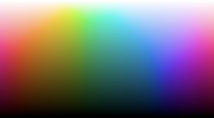
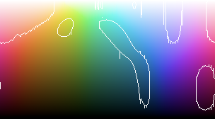

# Colors in Display P3 (#470): design note

Design only, nothing built. Each part ends with a recommendation. "Fits sRGB" means every sRGB
channel of the color is within 0–1.

## 1. Rendering

Today (Rune `5986ab76`): `rune::Color` is f32 **linear sRGB**; vertex colors reach the GPU as
`Float32x4`; the surface is `Bgra8Unorm` with blending in gamma sRGB (`srgb_blend`, on by default),
the `CAMetalLayer` is tagged `kCGColorSpaceSRGB` (`platform/macos/surface.rs`), and the Metal
backend asserts an sRGB color space. Values are clamped to 0–1 in three places: the shader's
`srgb_encode`, `Color::from_oklab`, and the 8-bit image atlas (`Rgba8UnormSrgb`), which the picker's
square and bar are drawn through. Headless snaps go through the same 8-bit offscreen format.

Two routes:

| | A. P3 surface | B. Extended-range sRGB |
|---|---|---|
| Layer, format | `kCGColorSpaceDisplayP3`, `Bgra8Unorm` | `kCGColorSpaceExtendedSRGB`, `Rgba16Float` |
| What a `Color` means | P3: every color, text, image and system color converted on the way in | linear sRGB as now; P3-only colors are just values below 0 or above 1 |
| Existing colors | all go through a conversion; a missed one draws oversaturated | bit-for-bit unchanged |
| Cost | none at runtime | a drawable twice the memory (about 33 MB rather than 16 MB per drawable at 2560×1600 pixels) |

**Recommendation: B**, as an opt-in in Rune, `App::wide_color(true)`. It's the route macOS takes
for wide color (`extendedSRGB`), and nothing that fits sRGB changes. The Rune change, about 400–700
lines with tests, needs your OK:

1. `wide_color`: an `Rgba16Float` surface, the layer tagged extended sRGB (extended *linear* sRGB
   when `srgb_blend` is off); the Metal backend's sRGB-only assert accepts it.
2. The shader's `srgb_encode` keeps the sign and doesn't clamp at 1, under `wide_color` only.
3. Images with wide pixels: `Pixels::set_f16` (linear extended sRGB) on an `Rgba16Float` atlas
   page, for the picker's square and bar.
4. The window's screen gamut (`NSScreen.canRepresent(.p3)`) and an event when it changes, as the
   window moves to another screen.
5. Headless: an `Rgba16Float` offscreen target and 16-bit PNGs tagged Display P3, so snaps and
   tests see P3 colors instead of clipped ones.

Phantom does its own unclamped OKLab conversion (it already has `lab_to_linear`), so Rune's
`from_oklab` clamp can stay.

## 2. Storage

A color in `gui.json` (Colors and `app_icon_settings` alike) is `"#rrggbb"` when it fits sRGB, else
`"color(display-p3 r g b)"`, each channel 0–1 to 4 decimals (CSS Color 4's form, numbers only: no
percentages or `none`). `Rgb` becomes:

```rust
pub enum Picked { Srgb([u8; 3]), P3([f32; 3]) } // P3 only when it doesn't fit sRGB
```

Every stored `#rrggbb` stays valid and means what it does now. A P3 color that fits sRGB snaps to
the nearest `#rrggbb` when stored, so one color has one spelling. No migration: an older build
reading `color(display-p3 …)` fails to parse it and resets that color, named in the settings-reset
notice, as it does for any invalid value. The **hex field** takes either form and shows the one
that's stored. It needs room for about 30 characters, so it may grow wider. This is a data format
change, so it needs your OK.

## 3. Picker

Okhsl is measured against P3's gamut instead of sRGB's: the same model, with the matrix from LMS to
linear P3 in place of `LMS_TO_RGB`. Ottosson's fits (`RED_ZERO`…, the branch lines, `s_mid` and
`t_mid`) are for sRGB only. **Recommendation:** find P3's maximum saturation and cusp numerically,
not with fits: Halley steps per channel from a fixed start, with the cusp cached per hue (one per
column of the square, 304). That's exact and needs no fitting script to maintain. Keep the sRGB fits
for `s_mid`/`t_mid`, which only shape the scale and don't decide what's in the gamut.

**Blue easing:** P3's blue primary is sRGB's, but its red primary is further out, so red runs out
later. Measured with the exact gamut, sRGB's maximum saturation jumps by 0.064 within 0.1° at 264.3°
(#454's seam). P3's has no jump, only a steep slope (about 0.009 per 0.1°) up to a sharp corner at
264.1°. **Recommendation:** no easing for P3, kept only if `okhsl_is_continuous_across_hue`
(ΔE < 1), run against P3, says otherwise.

**The sRGB edge** at the bar's saturation isn't a straight line through the square. It's a contour
of the hues and lightnesses that still fit sRGB at that saturation (blobs in the mock below), and it
moves with the bar. **Recommendation:** a 1 pt hairline, white with a dark shadow like the picker's
marker, drawn into the square's image rather than as an element. The **bar** stays a sweep of
saturation at the picked hue and lightness, with a tick where it leaves sRGB. Under the field, a
line says "Outside sRGB: shown only on wide-color screens" when the color doesn't fit.

## 4. sRGB displays

The window's screen gamut comes from Rune (part of §1); the picker redraws when it changes.

- **A, sRGB square there:** on an sRGB screen the picker is today's picker. A stored P3 color sits
  at the nearest sRGB color's place, with the line "Shown as the nearest sRGB color on this
  screen". Picking there stores sRGB. Mock: what `mock-srgb.png` shows, plus that line.
- **B, P3 square everywhere:** the same square and positions on every screen, with the sRGB edge
  drawn. Past the edge the screen clips, so the outer part shows as flat bands of one shade
  (`mock-p3-on-srgb.png`). The line says "This screen can't show colors past the line".

A shows only what the screen can show, and touching nothing keeps a P3 color stored. B keeps a
color's place in the square from one screen to the next, but puts bands that look broken where
colors are picked most. **Recommendation: A.** You decide.

## 5. Contrast and derived colors

Everything stays in linear sRGB, extended: luminance and WCAG contrast are linear in RGB, so they
hold for values outside 0–1 with no change. `opaque_over` mirrors Rune's blending, with a
sign-keeping encode. `ink_over` measures its "room" against P3's gamut when the color doesn't fit
sRGB, else sRGB's as now. `lerp_oklab` uses Phantom's unclamped conversion and clips to P3. Every
default is `#rrggbb` and fits sRGB, so its numbers are bit-for-bit today's. **No change to any
default:** a test compares every theme's resolved tokens, in both Appearances, before and after.

## 6. Plan

1. **Rune `wide_color`** (§1, items 1–5) upstream, then Phantom on the new rev with it off:
   *your OK, a Rune change.*
2. **`Picked` and `color(display-p3 …)`** in `gui.json` and the hex field, P3 values drawn clipped
   to sRGB for now: *your OK, a data format.*
3. **P3 Okhsl**, numeric edge and the continuity test, behind the picker as it is.
4. **`wide_color` on**, with the picker on P3 Okhsl, the sRGB edge, the bar's tick and the line.
   This changes the UI, so it needs your OK on the PR.
5. **sRGB displays** as you choose in §4, with contrast and ink against P3 and the defaults test.

## Mock (throwaway, not the app's code)

Okhsl squares at saturation 0.9 (hue across, lightness down), 16-bit PNGs tagged Display P3, made by
[`mock-p3-squares.py`](https://raw.githubusercontent.com/HugeLetters/phantom/pr-artifacts/470-p3-design/mock-p3-squares.py).
To see the difference, open them on a P3 screen in Safari or Preview.

| Today (sRGB) | P3 | P3 with the sRGB edge | P3 as an sRGB screen shows it |
|---|---|---|---|
|  |  |  |  |
