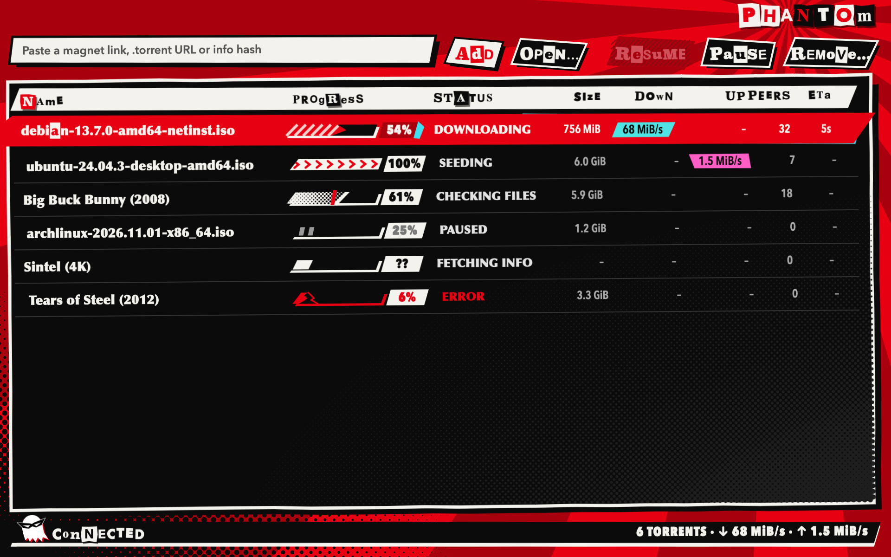
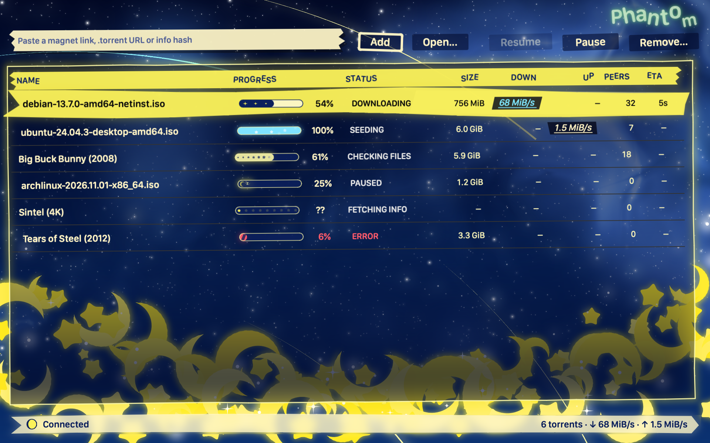

# Persona 5 themes: the design (#11)

The design for Phantom's two Persona 5 themes:
- **Persona 5: Phantom Thieves**, red, black and white, after the game's menus;
- **Persona 5: Jose's shop**, blue and yellow, after the shop in the game.

The production themes get their own issue. This folder is what they start from:

| | |
|---|---|
| [SPEC.md](SPEC.md) | every element of both themes: colours, fonts, states, motion timings |
| [reference/](reference/) | stills and clips of the settled designs, regenerated by `scripts/reference.sh` |
| `src/` | a standalone Rune crate that draws both themes on Phantom's layout; when the spec and a render disagree, the render wins |
| [ADR 0009](../../docs/adr/0009-persona-themes-drawn-in-code.md) | the themes are drawn in code, with a generated texture for the nebulae |
| [ADR 0010](../../docs/adr/0010-component-state-as-eased-amounts.md) | component state is drawn from eased amounts, never per state |
| [ITERATING.md](ITERATING.md) | what made the design rounds fast or slow, for the next theme |




The crate isn't app code or the `Theme` interface
([ADR 0004](../../docs/adr/0004-themes-override-building-blocks.md)). It sits outside the
workspace, pinned to the same Rune rev as `gui/Cargo.toml`.

## Rendering

Always use the release build: a frame at 2× takes about 0.4 s, against 10 s in debug.

```sh
cd design/persona5
scripts/play.sh                         # a window to click around; Switch swaps the themes
scripts/render.sh jose-shop             # window still, component sheet, a GIF of the pointer script, into out/
scripts/reference.sh                    # the whole reference set, about 25 minutes
scripts/reference.sh '*-progress*'      # only the matching files
cargo build --release && target/release/persona5-sketches \
  --snap out/x.png --scene phantom-thieves --size 960x600 --scale 2 --at 1.5
bun tools/px.ts diff a.png b.png        # pixel checks: also sky, mean
```

Use `--at 1.5` or later, so the window's appear motion has finished before the still is taken.
For clips, use `--script <pointer.json> --out <dir> --duration <s> --fps <n>`, then encode with
ffmpeg (see `scripts/reference.sh`). `out/` is gitignored. Delete `target/` when done: it grows to
about 2 GB.

Renders are byte-for-byte deterministic. To check a refactor, render the scenes before and after
and compare the frames: any difference is a real change.

**Scenes**, for both `phantom-thieves` and `jose-shop`:
- the window (`phantom-thieves`) and the component sheet (`-parts`);
- the long list scrolling (`-scroll`);
- a row added or removed (`-rows-add`, `-rows-remove`);
- progress reports smoothed (`-progress`), and every bar from 0 to 100 and back
  (`-progress-sweep`);
- a torrent pausing itself under a hovered Pause (`-status-flip`).

## Code

```
src/main.rs             # layout (window, component sheet), the Parts the themes fill in, scenes
src/common.rs           # theme switch, palette, fonts, state, hover/press tracking, demo torrents
src/themes.rs           # each Part, choosing between the two themes
src/phantom_thieves.rs  # the press wipe and ransom lettering, ghost, progress fill
src/jose_shop.rs        # button, bars and patterns, pill, footer moon, night sky
src/shapes.rs           # geometry: cut and jagged outlines, bursts, rounded corners, stars, moons, clipping
src/paint.rs            # layers, outlines, halftone, hatching
src/noise.rs            # seeded noise; value, fractal and ridged noise
src/nebula.rs           # the generated nebula texture
src/motion.rs           # eased component amounts, progress report smoothing
scripts/                # render.sh, reference.sh and their pointer scripts
tools/px.ts             # pixel checks on renders
```

`shapes` and `paint` use no theme colours or sketch state, so production can take them as they
are. `motion` and `noise` read the sketch's state (`S`) for time, pointer and seeds, and
`nebula` uses Jose's shop's colours; those need that state passed in.

## For the production themes

- **Cache what stands still.** The sketch redraws 40,000–53,000 shapes every frame and runs below
  60 fps even in release. Draw the still parts once: halftone, screentone, rims, the star field.
  Redraw only what moves, such as rays, living corners and stripes.
- **Jose's shop's stars:** bake the 2,400 stars' field, halos and soft cores into a texture once
  per window size and scale. Animate only the twinkling stars, as pre-blurred sprites.
- **Nebulae:** they're generated from domain-warped fractal noise and a seed (`nebula_rgba`). Make
  a texture per session from a random seed, and drift it. Nebulae that truly morph need a GPU
  shader through Rune's effect slots (`El::effect`), evaluated per pixel each frame.
- **Fonts:** every face is a macOS system font, named rather than bundled. Rune doesn't look
  system fonts up by name, and a face it hasn't loaded silently falls back to Inter. `main.rs`
  reads the files from `/System/Library/Fonts` at start, and a theme needs the same. No fan-made
  Persona 5 font is bundled: they have no licence, or forbid apps.
- **Motion is always on** in the sketch. In the app it becomes a setting.

The ransom letters swap between five faces, following a fan's guide to Persona 5 Royal's menu
fonts: Futura, Times New Roman, Superclarendon (a Clarendon), Helvetica Neue and Avenir Next (for
ITC Avant Garde). Fonts that may look nicer, to try later:

| Role | Font | Licence |
|---|---|---|
| list and body text | Optima Nova Black (what the game uses) | paid, about $90 for that style |
| list and body text | Arsenal, 15% wider | OFL, Google Fonts |
| condensed headings | Anton, Bebas Neue | OFL |
| serif letters | Playfair Display | OFL |
| tarot-card lettering | Bubblegum Superstar | $20 commercial, no middle dot |
| time, deadline, actions | Helvetica Now Display, or Franklin Gothic | the free weight is for graphics only |
| main-menu letter mix | Cooper Black, ITC Avant Garde / TeX Gyre Adventor, Clarendon, Noto Sans / Serif (accents) | mixed |

## Game references, local only

The game footage, screenshots and pattern crops behind these designs are copyrighted, and must
never be published: not in this repo, an issue, or the PR. They live in their own git repo,
`~/projects/personal/phantom-design-reference`. It has no remote, and its `pre-push` hook refuses
every push. Its `NOTES.md` says what each file shows and which element of ours it informed.

The repo sits outside every worktree, so removing a worktree can't delete it. Link it in with two
gitignored symlinks:

```sh
ln -s ~/projects/personal/phantom-design-reference out/reference
ln -s ~/projects/personal/phantom-design-reference/footage references
```
