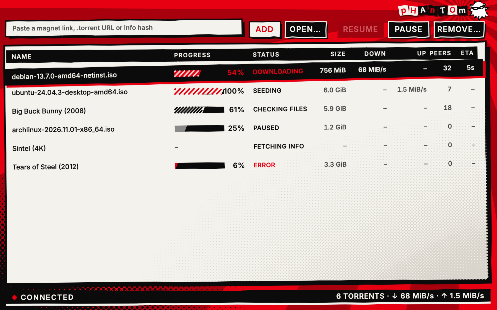
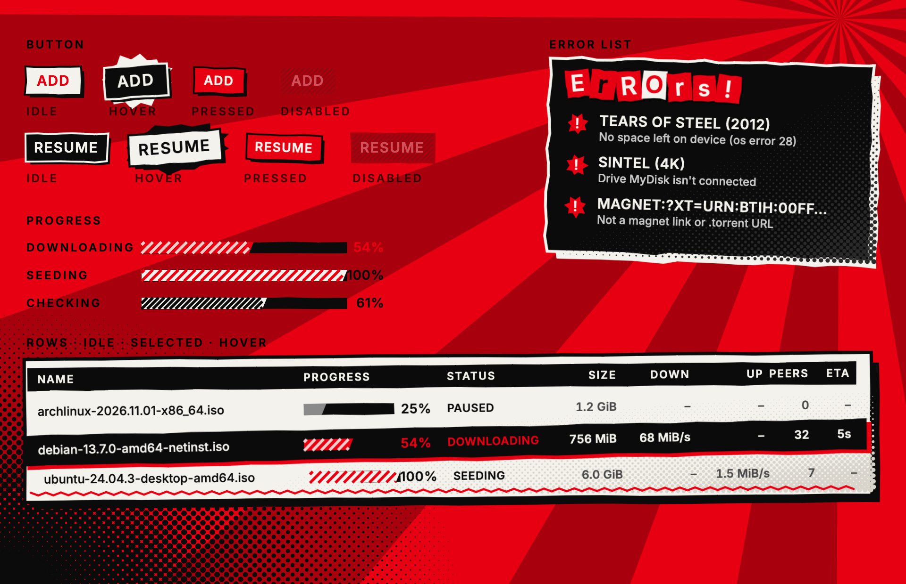
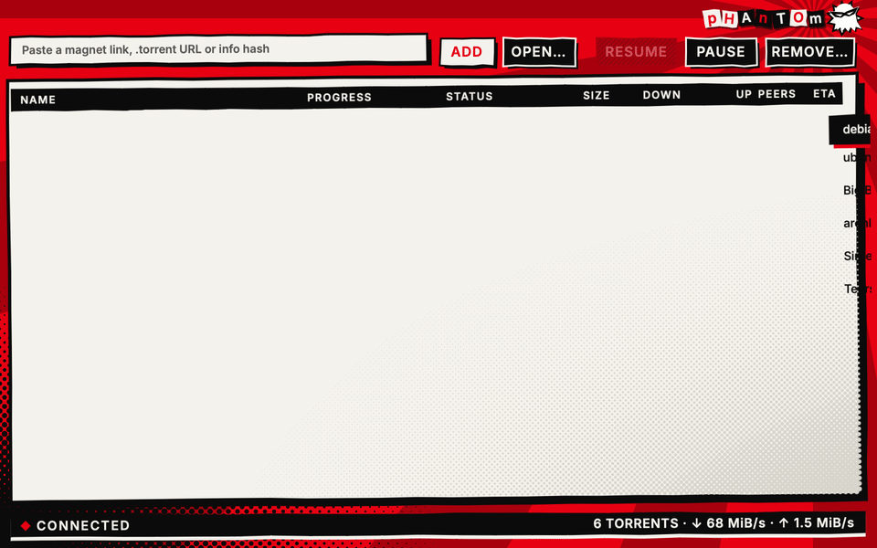

# Persona 5 theme sketches (#11)

A visual exploration of the Persona 5 theme on **throwaway components**. Nothing here is app code
or the `Theme` interface ([ADR 0004](../../docs/adr/0004-themes-override-building-blocks.md)):
it's a standalone Rune crate, outside the workspace, pinned to the same Rune rev as
`gui/Cargo.toml`, that draws Phantom's current layout (toolbar, torrent list, status bar). Style
cues only: no copied assets, logos or fonts. Every face named here ships with macOS, so a theme can
name it without bundling it.

The sketch has a window still, a component sheet (buttons in every state, progress bars, an error
list, rows idle/selected/hovered) and a GIF of a fixed script: hover and press Add, hover rows,
select a row, press Pause, select a paused torrent, press Resume.

## The direction: All-Out

A red ground with a slowly turning starburst and black halftone. The list sits on a tilted sheet of
white paper with a fat black outline. The buttons and the selection are black cut-out slabs, and
the edges are jagged rather than straight. Everything moves: rows slam in when they appear,
buttons kick up and turn with a burst on hover and crunch on press, progress stripes march, and the
ghost bobs.





## Next pass

- The titlebar title, plus livelier top-row buttons and their hover and press motion.
- Each status gets its own progress bar style: downloading, seeding, checking, paused, error,
  fetching.
- Active elements (hovered or pressed buttons, the selected row) take non-rectangular shapes, like
  Persona 5's menus, with a random tilt each time they become active.
- Motion is always on. In the real theme it becomes a setting.
- Fonts: what Persona 5 uses, and free lookalikes. The current face stays until then.
- Light / dark is set aside: design one good-looking theme first. Whether it gets a light and a dark
  variant, or neither, is decided later.

Open questions live on the desk.

## Files

```
Cargo.toml          # standalone crate, the same Rune rev as gui/; [workspace] keeps it out of the app's
src/main.rs         # the layout (window and component sheet), the Parts a direction fills in, scenes
src/common.rs       # palette, demo data, state, hover/press tracking; shapes: slant, jagged, inflate
                    #   (offset outlines), halftone, hatch, burst; the masked ghost; ransom()
src/attack.rs       # All-Out
src/card.rs         # an earlier direction, kept as a parts bin for the next pass
src/accent.rs       # an earlier direction, kept as a parts bin for the next pass
scripts/interact.json  # the GIF's pointer script
scripts/render.sh   # renders into out/ (gitignored)
```

Scenes: `attack` (window) and `attack-parts` (component sheet).

Halftone, screentone and bursts are vector shapes (`canvas`), not shaders or images: crisp at any
scale, and no compositor is needed. A shader would only pay off for whole-window textures that
move.

## Rendering

```sh
design/persona5/scripts/render.sh attack         # into design/persona5/out/
# one still by hand (from design/persona5):
cargo build && target/debug/persona5-sketches --snap out/attack.png --scene attack --size 960x600 --scale 2 --at 1.5
```

A GIF takes about 1.5 minutes (210 frames at 2×). `--at 1.5` lets the appear motion finish
before the still. Delete `design/persona5/target/` when done: it grows to about 2 GB.
