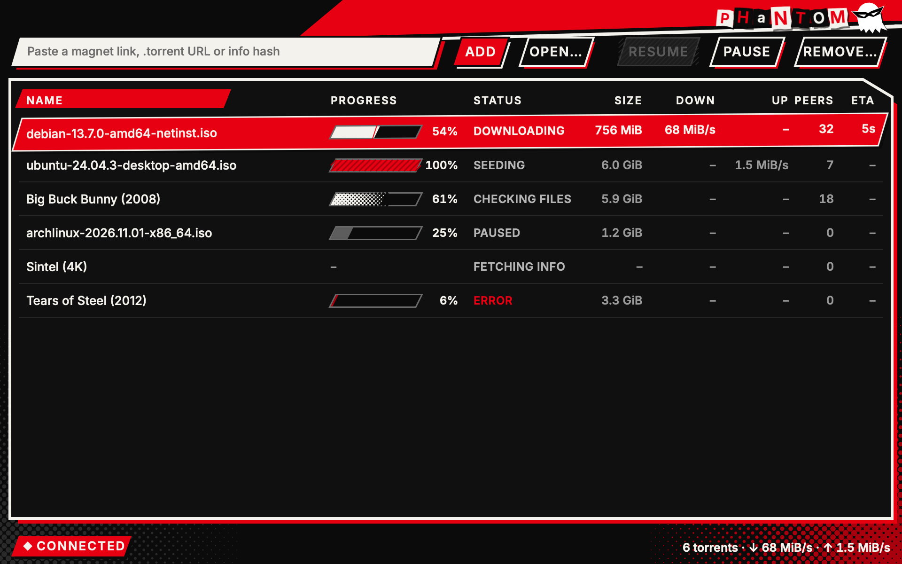
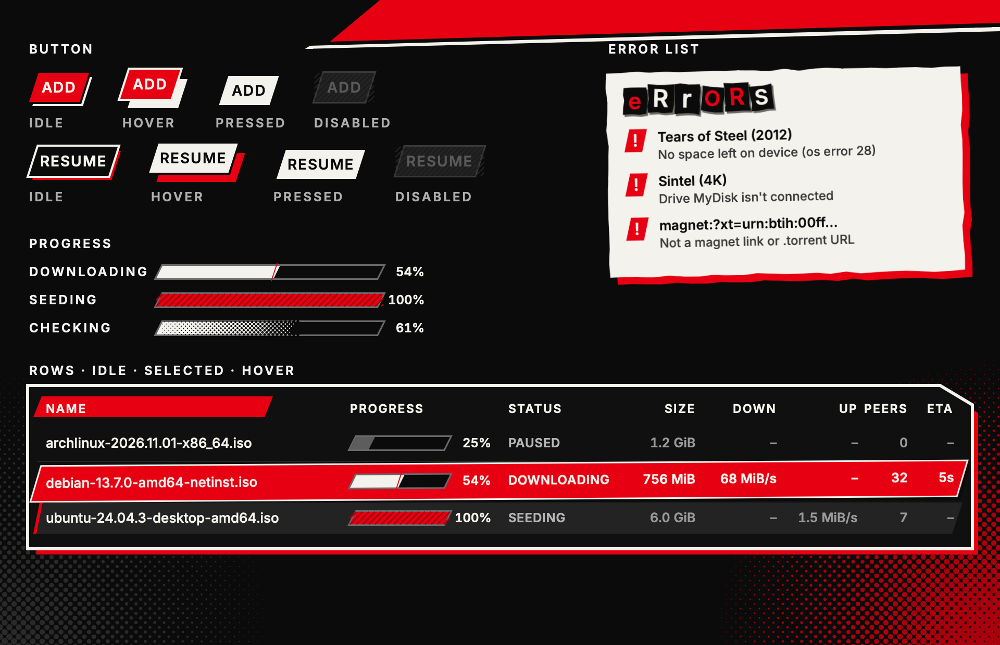
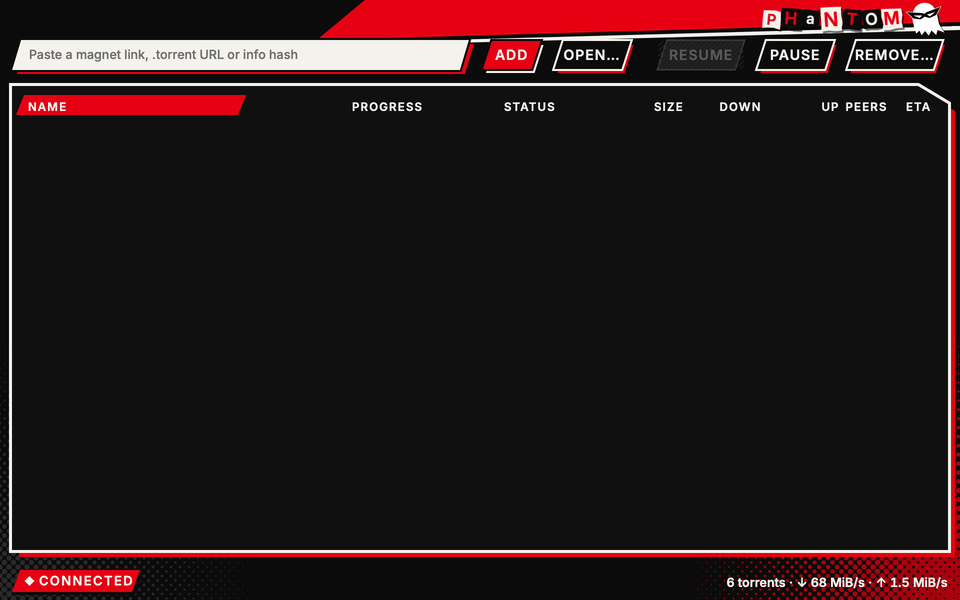
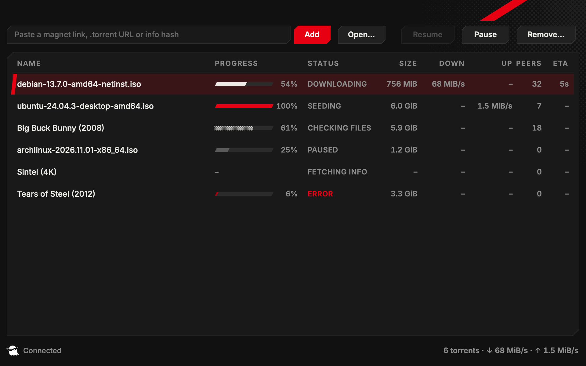
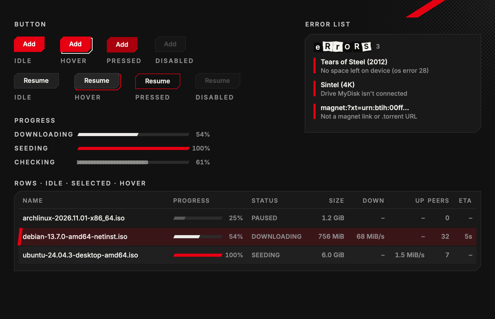

# Persona 5 theme sketches (#11)

A visual exploration of the Persona 5 theme on **throwaway components**. Nothing here is app code
or the `Theme` interface ([ADR 0004](../../docs/adr/0004-themes-override-building-blocks.md)):
it's a standalone Rune crate, outside the workspace, pinned to the same Rune rev as
`gui/Cargo.toml`, that draws Phantom's current layout (toolbar, torrent list, status bar) in three
directions. Style cues only: no copied assets, logos or fonts. Every face named here ships with
macOS, so a theme can name it without bundling it.

Each direction has a window still, a component sheet (buttons in every state, progress bars, an
error list, rows idle/selected/hovered) and a GIF of the same script: hover and press Add, hover
rows, select a row, press Pause, select a paused torrent, press Resume.

## A. Calling Card (bold, graphic)

Black ground, a red slash through the titlebar, white slanted slabs with thick offset outlines and
a red slab for the selection. Halftone sits in the corners. Buttons jump off their shadow on
hover and slam into it on press. Rows cut in on appear. The ransom-note "PHANTOM" and the masked
ghost sit in the titlebar.





## B. Accent (restrained)

Phantom's calm dark window with Persona 5 only at the edges: clipped corners, a red slash for the
selection, a red offset outline that springs out on hover, faint screentone in one corner, and
ransom letters only on the error list's heading. Sentence-case labels, small and quick motion.





## C. All-Out (maximal, animated)

A red ground with a slowly turning starburst and black halftone. The list sits on a tilted sheet of
white paper with a fat black outline, and the buttons and the selection are black cut-out slabs.
Everything moves: rows slam in on appear, buttons kick up and turn with a burst on hover and
crunch on press, progress stripes march, and the ghost bobs.


## Recommendation

**A as the base, with B's restraint where you read and C's motion where you act.** A is the most
recognisably Persona 5 and stays legible: the list is still black with white text, and red marks
only what matters (the selection, the primary action, errors). Take from B: sentence-case or
lighter labels in the list body, and halftone kept to the corners. Take from C: the hover burst and
press crunch on buttons, the selection's slam-in, and marching stripes on Checking only, which
signal work in progress. C's full red ground and tilted paper are great for a splash but tiring
behind a list you watch for hours. B alone reads as "Phantom with a red accent", not as a theme.

## Open questions

- **Which direction to refine**, and what to push or pull back (red ground, tilt, jaggedness, caps
  labels, amount of halftone).
- **Brand in the titlebar**: A and C add a ransom-note "PHANTOM" and the ghost at the top right,
  in the titlebar strip that is empty today. That's new content, not just a restyle. Keep it, or
  move the ghost to the status bar as B does?
- **Ransom-note faces**: Futura, Didot, American Typewriter, Avenir Next Condensed, Georgia and
  Rockwell, all macOS system fonts. Fine to rely on them, or bundle one licensed display face?
- **Caps everywhere?** A and C set button labels, column headings and statuses in condensed caps;
  names stay in mixed case. Is that too loud?
- **Light palette**: ADR 0004 says Persona themes ignore the system Appearance and may offer their
  own palettes. Is a white-paper palette (C's sheet as the whole window) wanted?
- **Motion that never stops** (C's starburst, marching stripes, bobbing ghost) keeps the window
  drawing. For the real theme it should stop at rest, or be a theme setting ("animations").

## Files

```
Cargo.toml          # standalone crate, the same Rune rev as gui/; [workspace] keeps it out of the app's
src/main.rs         # the layout (window and component sheet), the Parts each direction fills in, scenes
src/common.rs       # palette, demo data, state, hover/press tracking; shapes: slant, jagged, inflate
                    #   (offset outlines), halftone, hatch, burst; the masked ghost; ransom()
src/card.rs         # A: Calling Card
src/accent.rs       # B: Accent
src/attack.rs       # C: All-Out
scripts/interact.json  # the GIF's pointer script
scripts/render.sh   # renders everything into out/ (gitignored)
```

Scenes: `card`, `accent`, `attack` (window), and `card-parts`, `accent-parts`, `attack-parts`
(component sheet).

Halftone, screentone and bursts are vector shapes (`canvas`), not shaders or images: crisp at any
scale, and no compositor is needed. A shader would only pay off for whole-window textures that
move.

## Rendering

```sh
design/persona5/scripts/render.sh                # all three, into design/persona5/out/
design/persona5/scripts/render.sh card           # one direction
# one still by hand (from design/persona5):
cargo build && target/debug/persona5-sketches --snap out/card.png --scene card --size 960x600 --scale 2 --at 1.5
```

A GIF takes about 1.5 minutes (210 frames at 2×). `--at 1.5` lets the appear motion finish
before the still. Re-publish with
`scripts/pr-artifacts.sh 11-persona5-sketches design/persona5/out/*`. Delete
`design/persona5/target/` when done: it grows to about 2 GB.
